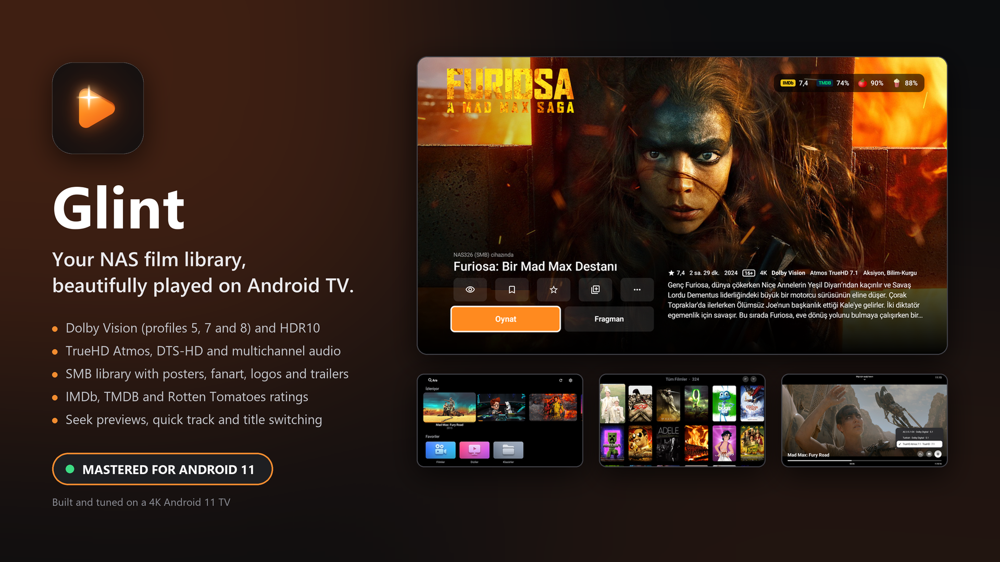

<p align="center">
  
</p>

# Glint



A media player for Android TV that turns the films and series on your NAS into a polished library:
posters, fanart, logos, plots, cast, trailers and ratings, with playback built for home cinema.
Dolby Vision, HDR10, lossless surround sound and frame-rate matching, straight from your own shares.

Mastered for Android 11 and built on a 4K Philips Android 11 TV. It runs on Android 7.0 and later.

Glint plays your own files and has no account, no server and no tracking. The only online lookups are
the film details from TMDB and the ratings from OMDb, both with free keys you enter yourself, and
YouTube when you open a trailer.

## Features

- **Picture:** Dolby Vision profiles 5, 7 and 8 on TVs with a Dolby Vision decoder (profile 7 converted
  to 8.1 on the fly when needed), HDR10, and the TV switched to the film's frame rate (24 Hz for films).
- **Sound:** TrueHD Atmos, DTS-HD, Dolby Digital Plus and multichannel tracks. With passthrough on,
  Dolby goes to your TV or receiver untouched, and DTS is decoded in the app for TVs that can't play it.
- **Library:** films, series with seasons and episodes, collections, genres and folders, matched with
  [TMDB](https://www.themoviedb.org/). Local `.nfo` files and artwork next to your files are used too.
- **Ratings:** IMDb, TMDB and Rotten Tomatoes scores on every film page.
- **Shares:** SMB (with a selectable SMB version for older NAS boxes), WebDAV, FTP, FTPS, SFTP, NFS and
  UPnP/DLNA, and USB disks plugged into the TV (new, lightly tested; subtitle and .nfo files on a USB disk
  aren't read, since Glint only asks Android for its videos and pictures).
- **Playback:** seek previews while scrubbing, chapters, resume points, skip intro and credits,
  subtitle styling and timing, audio sync, and quick switching of audio, subtitles and titles from the
  playbar.
- **People at home:** profiles with age limits and a PIN, watchlist, playlists, your own collections,
  watched marks and ratings.
- **Yours to set:** 10 interface languages (English, Türkçe, Deutsch, Español, Italiano, Français,
  Português, Nederlands, Polski, Русский), black, dark grey or light appearance, and 8 theme colours.
- **Backup:** profiles, watch history, lists and settings saved to `Glint/backup.json` on your NAS and
  restored from it.

## Install

Glint is coming to Google Play for Android TV. Until then, build it from source (see below) and install
it on your TV with `adb install`.

Open Glint from the TV's apps, choose **Add a share**, pick your NAS and the shares to use. The library
fills in while the files are matched. Updates install over the old version and keep your library and
settings.

### Your own API keys

Film details and ratings come from free services, with keys you get yourself and enter in Glint's
**Settings → Metadata & Artwork**:

- **TMDB API key**, from [themoviedb.org](https://www.themoviedb.org/settings/api) (free account, then
  Settings → API): titles, plots, cast, posters, artwork and trailers. Without it, films and series show
  their NAS posters, `.nfo` details and file names.
- **OMDb API key**, from [omdbapi.com](https://www.omdbapi.com/apikey.aspx) (free): IMDb and Rotten
  Tomatoes scores. Without it, film pages show only the TMDB score.

Glint checks each key when you enter it, and a library update then fills in the details.

## Building from source

Requires the Android SDK and JDK 17 (Android Studio brings both).

1. Copy `local.properties.example` to `local.properties` and fill it in:
   - `sdk.dir`: your Android SDK path (Android Studio sets this for you).
   - `release.*`: optional, your own signing key. Without it, release builds are signed with the debug key.
2. Build and install:

   ```
   ./gradlew assembleRelease
   adb install -r app/build/outputs/apk/release/app-release.apk
   ```

   The release build (shrunk with R8) is the one to use even for testing: debug builds of Compose are
   slow on TV boxes.

   No API keys are built in: enter yours in the app, as above.

Unit tests run with `./gradlew testReleaseUnitTest`.

## Code

Everything is in `app/src/main/java/com/glint/player/`:

| File | What it does |
|---|---|
| `MainActivity.kt` | Screens and navigation, the welcome screen and text input |
| `Browse.kt` | Home, the film and series grids, genres, collections and search |
| `Detail.kt` | Film and series pages: artwork, ratings, cast, versions and actions |
| `PlayerActivity.kt` | Playback with libVLC: tracks, frame-rate matching, resume, intro skipping |
| `PlayerOverlay.kt` | The playbar, the playback menu and the track lists |
| `DolbyVision.kt`, `DoviConvert.kt` | Dolby Vision playback with Media3, and the profile 7 to 8.1 conversion |
| `SeekThumbs.kt` | Pictures for the seek preview |
| `Library.kt` | Scanning shares, the library, watch progress, profiles and backups |
| `Names.kt`, `Nfo.kt`, `Dubs.kt` | Reading titles, years and episodes from file names, `.nfo` files and dub audio |
| `Tmdb.kt`, `Imdb.kt` | Film details from TMDB; IMDb and Rotten Tomatoes ratings from OMDb |
| `Smb.kt`, `SmbRelay.kt`, `Remote.kt` | SMB and the other kinds of shares, and USB disks |
| `Setup.kt`, `SettingsUi.kt`, `Settings.kt` | Adding shares, the settings screens and stored settings |
| `Profiles.kt` | Profiles, PINs and age limits |
| `AppLanguage.kt` | The interface language |
| `Ui.kt`, `TileIcons.kt` | Shared look: colours, type, cards, buttons and icons |

## Contributing

Bug reports, fixes and ideas are welcome. See [CONTRIBUTING.md](CONTRIBUTING.md), and report security
problems privately as described in [SECURITY.md](SECURITY.md).

## License

Glint is free software under the [GNU General Public License v3.0](LICENSE): you may use, study, change
and share it, and changed versions you share must stay under the same license with their source code
available.

It is built on open-source libraries, listed with their licenses in
[THIRD_PARTY_NOTICES.md](THIRD_PARTY_NOTICES.md).

This product uses the TMDB API but is not endorsed or certified by TMDB. IMDb and Rotten Tomatoes scores
come from the OMDb API with the viewer's own key; IMDb and Rotten Tomatoes are trademarks of their owners,
and Glint is not affiliated with IMDb, Rotten Tomatoes or OMDb. Film and series artwork belongs to its
respective owners.
